# Lettercombinaties (apart spoor)

Combinaties 4, 6, 8 en 10 (met een smalle letter voor de tool) zijn afgevallen. Alle combinaties zijn schreefloos, zoals de Word-bestanden (Aptos). De Bijbeltekst (bron en vereenvoudiging) heeft een andere letter dan de tool (menu, knoppen, regels, panelen). De opmaak uit Word (kleuren, arcering, vet, cursief) blijft gelijk; alleen de letter verandert.

Getoond op de layout van variant a. Afgerond: gekozen is Atkinson Hyperlegible Next voor de tekst en Inter voor de tool (zie `../stap2-plan.md`); de keuzeschakelaar voor letters is weg. Tekst- en toolletter los proberen kan nog met `?tekst=<naam>&tool=<naam>` in het adres.

Aptos zelf staat niet op Google Fonts en is geen open webletter; daarom gaat de zoektocht naar letters die erop lijken. Elke combinatie noemt Aptos als terugval, dus op een computer met Office valt de tekst terug op Aptos als de webletter niet laadt.

Bij een keuze leveren we de letters zelf mee met de site (geen verzoek naar Google bij elke bezoeker).

## 1. Figtree (tekst) en IBM Plex Sans Condensed (tool)

Figtree is open en vriendelijk, dicht bij Aptos. De tool in een smalle letter.

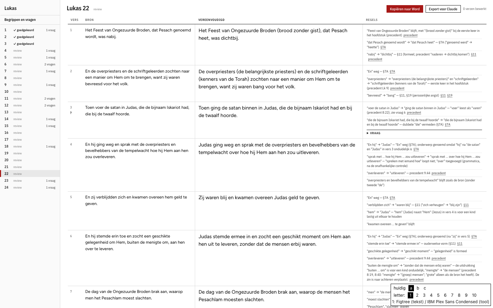

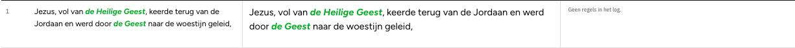

## 2. Instrument Sans (tekst) en Inter (tool)

Instrument Sans is iets strakker en smaller. De tool in Inter, neutraal.

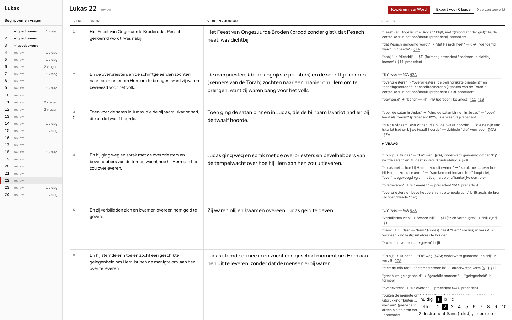

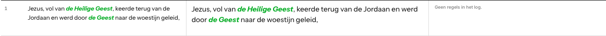

## 3. Hanken Grotesk (tekst) en IBM Plex Mono (tool)

Hanken Grotesk is rustig en rond. De tool monospaced, dus duidelijk gereedschap.

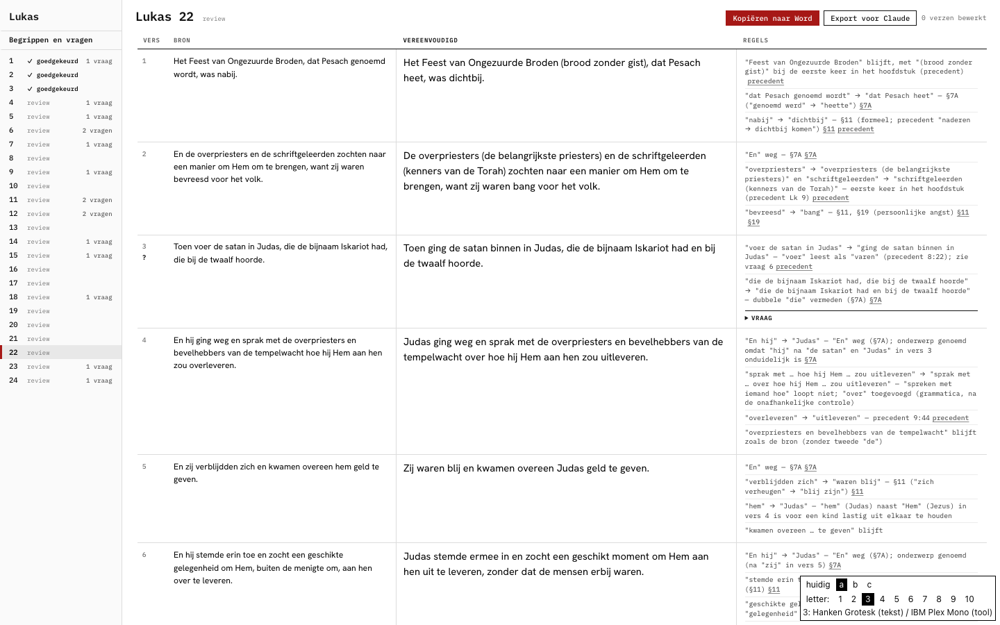

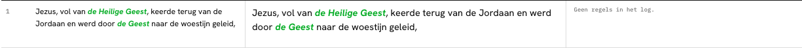

## 5. Schibsted Grotesk (tekst) en DM Mono (tool)

Schibsted Grotesk heeft wat meer karakter. De tool in een zachte monospaced.

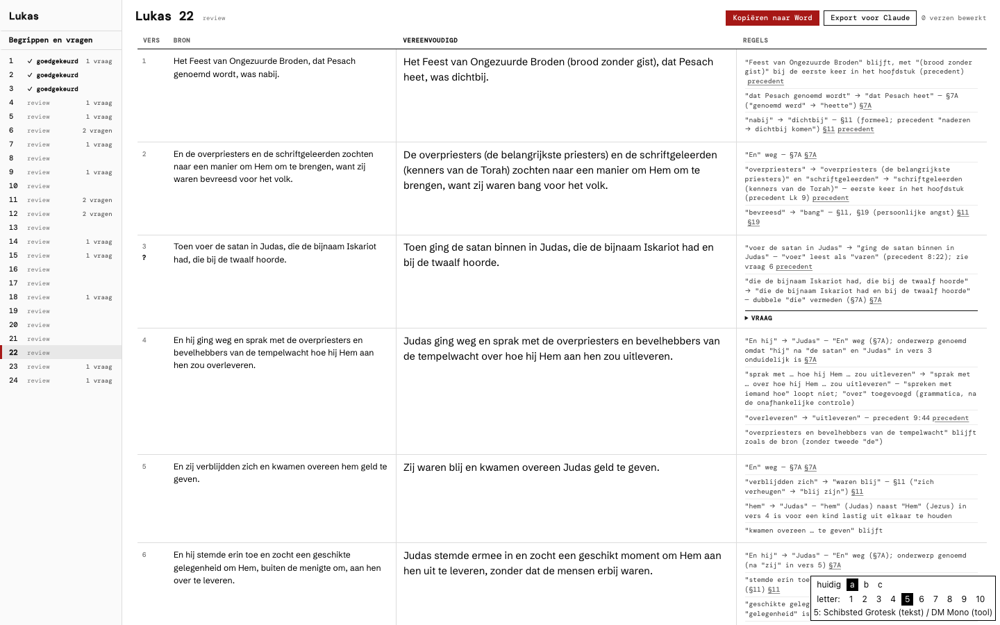

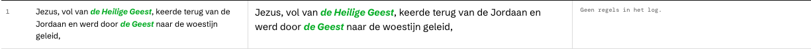

## 7. Source Sans 3 (tekst) en Source Code Pro (tool)

Source Sans 3 is een klassieke humanistische letter. De tool in de bijpassende monospaced.

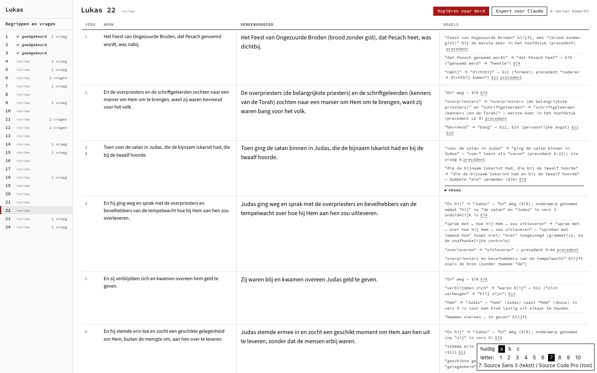

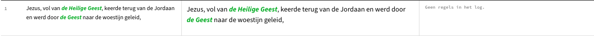

## 9. Red Hat Text (tekst) en Red Hat Mono (tool)

Red Hat Text is warm en goed leesbaar klein. De tool in de bijpassende monospaced.

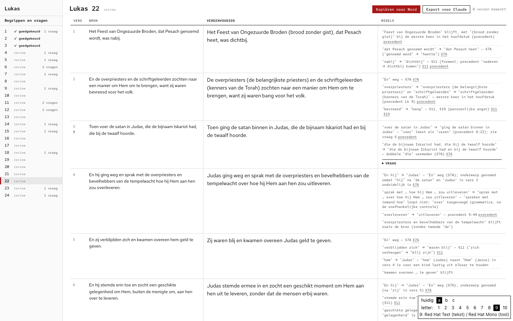

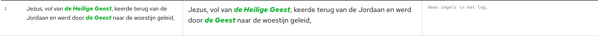

